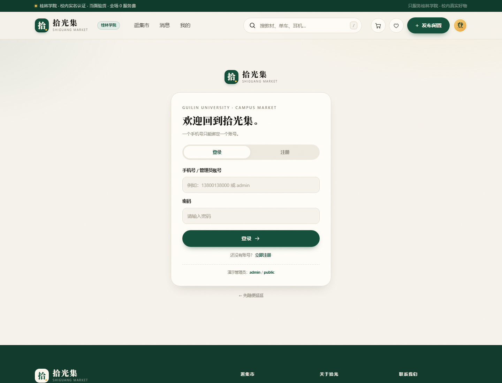
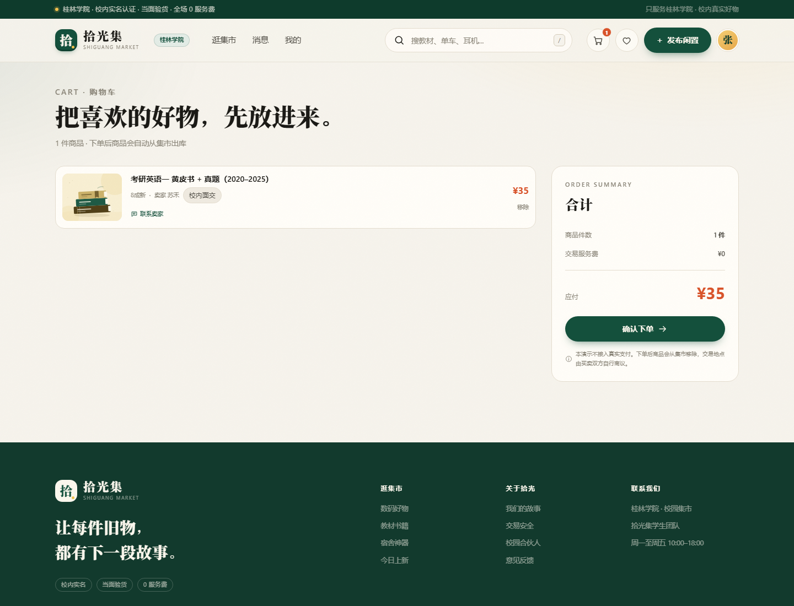
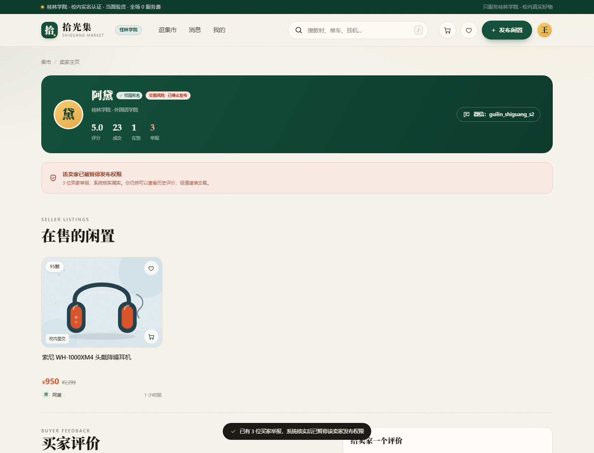
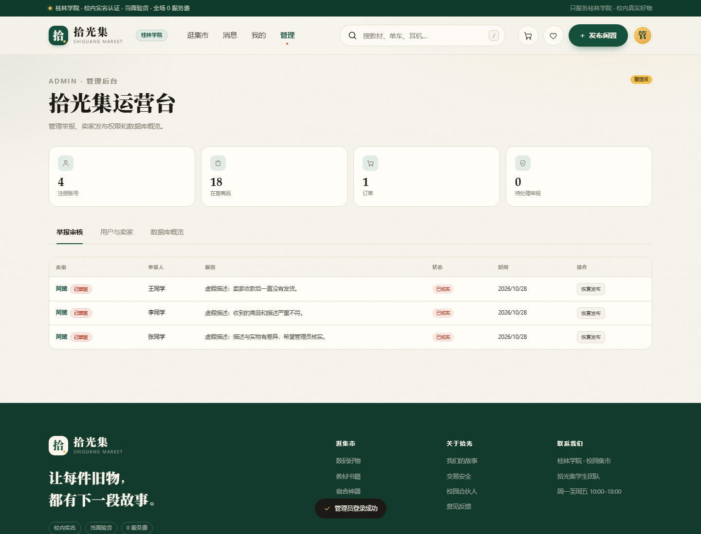
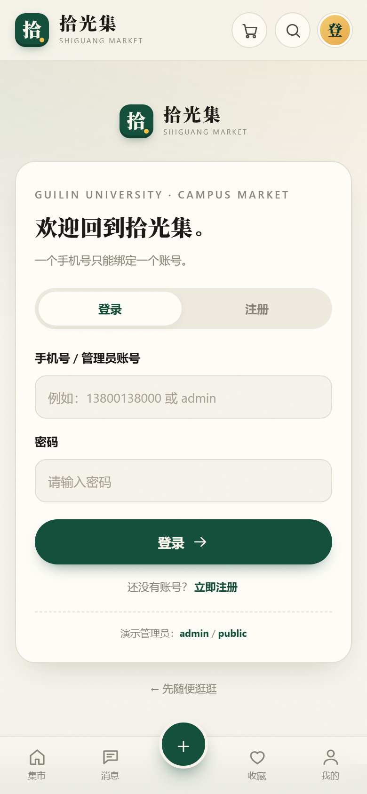
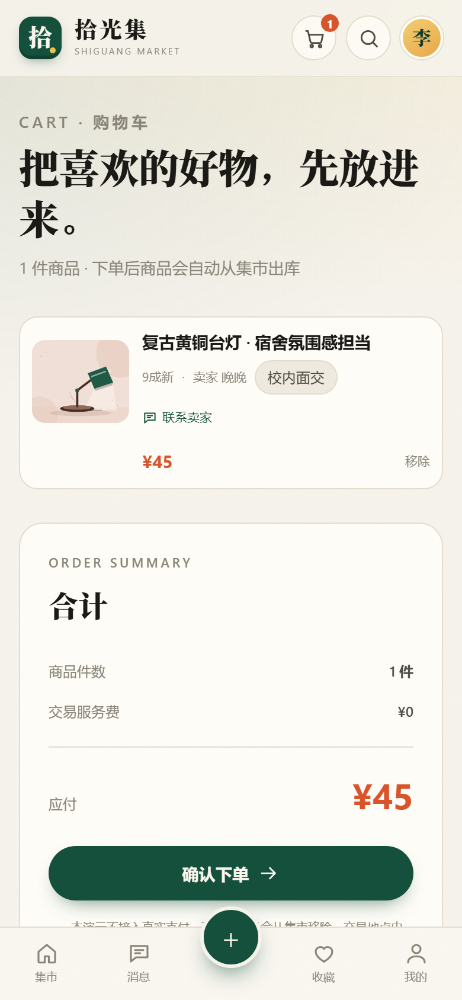

# 拾光集 · 桂林学院校园二手交易平台

> 让好东西，在校园里再遇见一次。

「拾光集」是**桂林学院**专属的校园二手交易平台。教材、单车、耳机、台灯、宿舍小电器，都可以在这里交给下一位同学。

技术栈：**Vue 3 + Vite + IndexedDB**。没有后端服务器，数据库运行在浏览器里，适合课程设计、毕业作品和 GitHub Pages 演示。

**在线访问：** <https://huangb-ux.github.io/GLC-Shi-Guang-Mall/>


## 这次新增的功能

- **注册 / 登录**：手机号 + 密码，一个手机号只能注册一个账号
- **管理员账号**：`admin` / `public`，登录后进入管理后台
- **发布不再填写交易地址**：交易地点由买卖双方自行商议
- **卖家必须留联系方式**：发布时必填微信号或 QQ 号，展示在商品详情和卖家主页
- **购物车**：加入购物车、批量下单、自动出库
- **买家评价**：给卖家打 1–5 星并写评价
- **举报卖家**：3 个不同买家举报后，系统自动核实并暂停卖家发布权限
- **卖家主页**：展示在售商品、评分、成交、举报次数和风险标记
- **管理员后台**：查看举报、核实 / 驳回、恢复卖家发布权限、查看数据库统计
- **IndexedDB 数据库**：发布自动入库，售出自动出库

### 页面预览

| 登录 / 注册 | 商品详情（含联系方式） |
| --- | --- |
|  |  |

| 发布闲置 | 购物车 |
| --- | --- |
|  |  |

| 3 次举报后的卖家主页 | 管理员后台 |
| --- | --- |
|  |  |

### 更多页面

| 搜索筛选 | 手机端首页 |
| --- | --- |
|  |  |

| 手机端登录 | 手机端购物车 |
| --- | --- |
|  |  |

## 三种角色

| 角色 | 能做什么 |
| --- | --- |
| 游客 | 浏览首页、搜索、详情；收藏 / 购物车 / 发布 / 私信会提示登录 |
| 普通用户 | 注册登录、发布、编辑、下架、收藏、购物车、下单、评价、举报 |
| 管理员 | 普通用户能力 + 管理后台：审核举报、恢复发布权限、查看账号和数据库统计 |

**演示管理员：**

```text
账号：admin
密码：public
```

普通用户直接注册即可。一个手机号只能注册一个账号，数据库对手机号建了唯一索引。

## 数据库设计

使用浏览器内置的 **IndexedDB**（数据库名 `shiguang-db`）。

| 表 | 作用 |
| --- | --- |
| `accounts` | 账号、手机号（唯一索引）、密码哈希、角色、发布权限 |
| `listings` | 商品；发布时写入，下单后删除（自动出库） |
| `carts` | 每个用户一份购物车 |
| `orders` | 订单快照；包含商品、卖家联系方式和总价 |
| `reports` | 买家举报；3 个不同买家后自动标记属实 |
| `feedback` | 买家对卖家的评分和评价 |
| `sellerFlags` | 卖家禁发标记和原因 |
| `meta` | 演示数据是否已经初始化，避免售罄后重新灌入种子商品 |

**入库 / 出库流程：**

1. 发布闲置 → 写入 `listings`
2. 下单 → 写入 `orders`，删除 `listings` 对应记录，清空购物车
3. 集市只展示仍在 `listings` 里的商品，所以售出后自动消失

> GitHub Pages 是静态托管，没有服务器，因此这是“当前浏览器里的数据库”。换电脑或清空浏览器数据后不会同步。要做真正跨设备的平台，需要把 `src/lib/db.js` 换成后端 API。

## 举报与禁发规则

1. 同一个买家对同一个卖家只能举报一次
2. 不同买家举报数达到 **3** 时，系统自动：
   - 把这名卖家的举报标记为“已核实”
   - 设置 `publishBanned = true`
   - 卖家主页出现「交易风险 · 已停止发布」
   - 卖家打开发布页时只看到“发布权限已被暂停”
3. 管理员可以在后台「核实并禁发」「驳回」或「恢复发布」

想演示三次举报，可以注册 3 个手机号，分别进入同一个卖家主页提交举报。

## 技术栈

| 层 | 选型 |
| --- | --- |
| 框架 | Vue 3（Composition API / `<script setup>`） |
| 构建 | Vite 7 |
| 路由 | Vue Router 4（Hash 模式） |
| 状态 | Vue `reactive` 共享 store |
| 数据库 | IndexedDB（自己封装的 Promise 版工具） |
| 密码 | Web Crypto SHA-256 + 随机盐（演示用途） |
| 样式 | 原生 CSS + CSS Variables |
| 插画 | 内联 SVG |
| 部署 | GitHub Actions + GitHub Pages |

没有使用 Element Plus、Tailwind、Pinia 或后端框架。每一层都可以在答辩时讲清楚。

## 项目结构

```text
GLC-Shi-Guang-Mall/
├─ index.html
├─ package.json
├─ vite.config.js                 # base: './'，适配 GitHub Pages
├─ src/
│  ├─ main.js                     # 先初始化数据库，再挂载 Vue
│  ├─ App.vue                     # 全局布局、聊天、弹窗、Toast
│  ├─ router/index.js             # 路由和登录/管理员守卫
│  ├─ styles/main.css             # 全部样式
│  ├─ data/site.js                # 桂林学院、分类、18 件种子商品
│  ├─ lib/
│  │  ├─ db.js                    # IndexedDB 封装 + 管理员初始化
│  │  ├─ art.js                   # SVG 插画库
│  │  ├─ format.js                # 价格、时间、封面匹配
│  │  └─ image.js                 # 图片压缩
│  ├─ stores/
│  │  ├─ market.js                # 账号、商品、购物车、订单、举报、评价
│  │  └─ ui.js                    # Toast、确认弹窗、聊天抽屉
│  ├─ components/                 # 头部、卡片、聊天、弹窗等
│  └─ views/
│     ├─ HomeView.vue
│     ├─ SearchView.vue
│     ├─ ItemView.vue
│     ├─ PublishView.vue
│     ├─ SellerView.vue           # 卖家主页 + 评价 + 举报
│     ├─ CartView.vue
│     ├─ OrdersView.vue
│     ├─ MeView.vue
│     ├─ LoginView.vue
│     ├─ AdminView.vue
│     └─ ...
├─ docs/                          # README 截图
└─ .github/workflows/deploy.yml
```

## 本地运行

```bash
npm install
npm run dev
```

打开 <http://127.0.0.1:5173>。

生产构建：

```bash
npm run build
npm run preview
```

## 部署

推送到 `main` 后，GitHub Actions 自动构建并发布到 GitHub Pages：

<https://github.com/huangb-ux/GLC-Shi-Guang-Mall/actions>

首次部署需要在仓库 **Settings → Pages** 中确认 Source 为 **GitHub Actions**。

## 演示步骤

1. 打开首页，右上角显示「登」，说明是游客
2. 点击「注册」，用手机号注册一个账号
3. 退出登录，再用同一个手机号注册，会提示“已经注册过了”
4. 登录后点击「发布闲置」，填写标题、价格、微信/QQ、描述
5. 发布成功后，商品详情会显示卖家联系方式；交易方式显示“买卖双方自行商议”
6. 用另一个账号把商品加入购物车并下单
7. 回到首页，商品已经消失；在「我的订单」里可以看到订单和联系方式
8. 进入卖家主页，提交评价或举报
9. 用 3 个不同账号举报同一个卖家，卖家主页会出现风险标记
10. 用 `admin / public` 登录，在管理后台查看和处理举报

## 说明

- 这是课程设计 / 作品集项目，不接入真实支付
- 密码哈希只能提高演示安全性，真正的生产环境必须由后端处理密码和身份认证
- 数据存于当前浏览器，无法跨设备同步
- 种子商品和演示卖家为虚构数据

---

<p align="center">拾光集 · 让每件旧物，都有下一段故事。</p>
