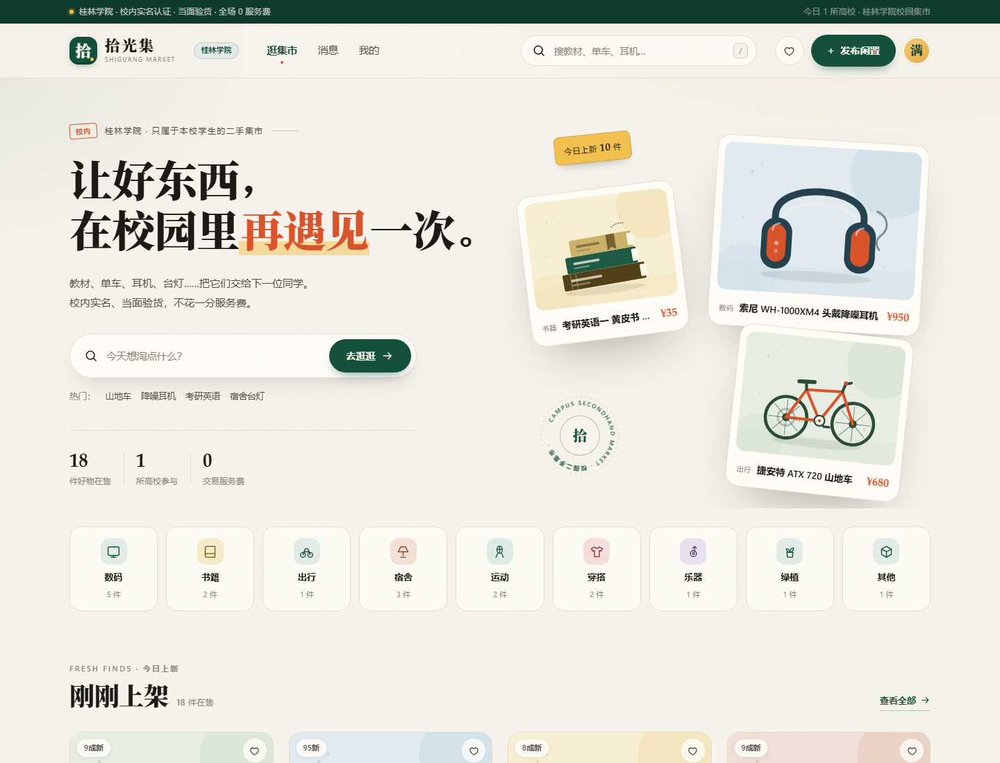
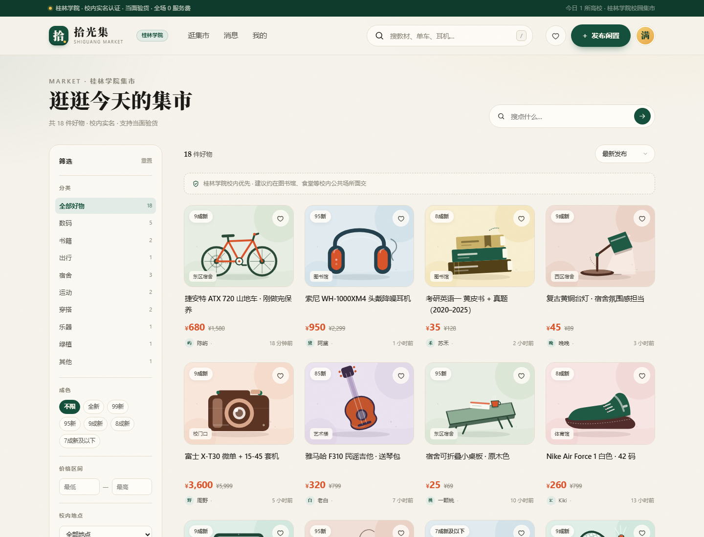
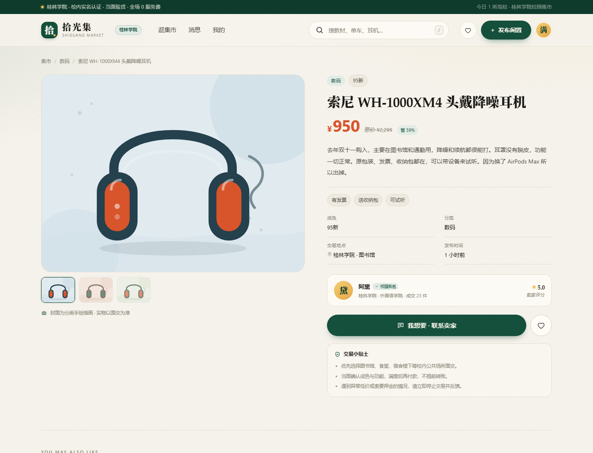
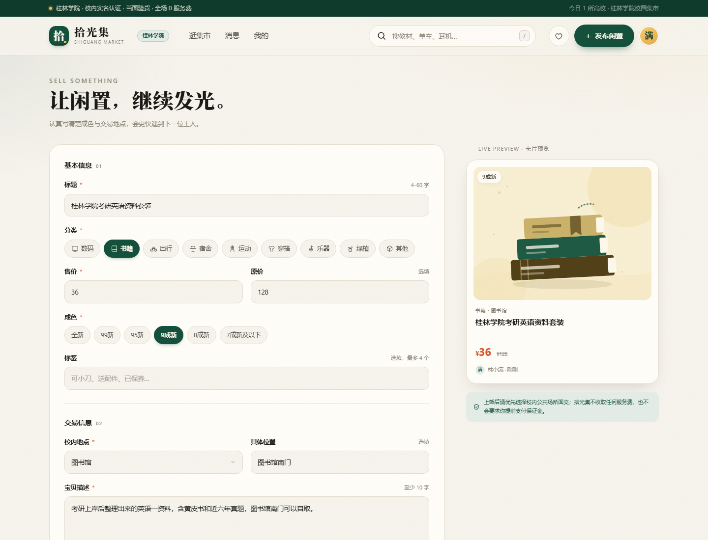
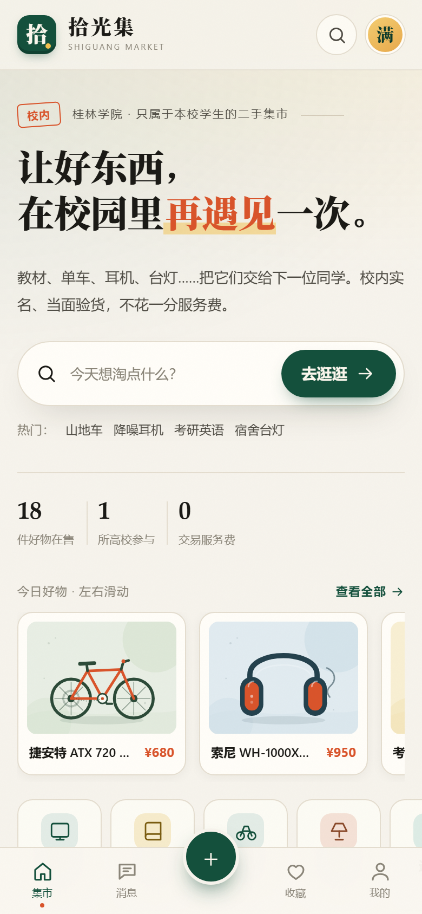

# 拾光集 · 桂林学院校园二手交易平台

> 让好东西，在校园里再遇见一次。

「拾光集」是**桂林学院**专属的校园二手交易平台。教材、单车、耳机、台灯、宿舍小电器，都可以在这里交给下一位同学。平台主打：**校内实名、当面验货、0 服务费**。

这是用 **Vue 3 + Vite** 从零重构的版本，数据、交互和视觉都围绕桂林学院单校区重新整理。

**在线访问：** <https://huangb-ux.github.io/GLC-Shi-Guang-Mall/>



## 技术栈

| 层 | 选型 | 说明 |
| --- | --- | --- |
| 框架 | Vue 3（Composition API） | 用 `<script setup>` 写组件 |
| 构建 | Vite 7 | 开发热更新、生产打包 |
| 路由 | Vue Router 4（Hash 模式） | GitHub Pages 静态托管无需 404 重写 |
| 状态 | Vue `reactive` 共享 store | 商品、收藏、私信、搜索历史 |
| 样式 | 原生 CSS + CSS Variables | 延续暖纸张 / 深松绿 / 橘色的视觉系统 |
| 插画 | 内联 SVG | 17 类物品手绘插画，不依赖网络图片 |
| 持久化 | localStorage | 发布、收藏、私信、搜索记录 |
| 图片 | FileReader + Canvas | 上传后压到最长边 1000px |
| 部署 | GitHub Actions + GitHub Pages | 推送到 main 自动构建发布 |

没有使用 Element Plus、Tailwind 或 UI 模板，页面结构和视觉都是手写的，方便在答辩时讲清楚每一层。

## 功能

- **首页**：品牌 Hero、搜索、分类入口、刚刚上架、百元以内、信任说明
- **搜索筛选**：关键词、分类、成色、价格区间、校内地点、三种排序
- **商品详情**：多图切换、价格、成色、描述、标签、交易地点、卖家评分、收藏、联系卖家
- **发布 / 编辑**：表单校验、图片上传压缩、封面标记、实时卡片预览
- **自动封面**：没有照片时，根据标题匹配相机、耳机、书、球拍等手绘插画
- **个人中心**：发布统计、编辑、下架 / 重新上架、删除二次确认、收藏夹
- **私信**：按商品聚合会话、快捷话术、模拟自动回复、未读红点
- **响应式**：桌面四列、手机两列；手机端筛选底部抽屉、详情页固定操作栏

### 页面预览

| 搜索筛选 | 商品详情 |
| --- | --- |
|  |  |

| 发布闲置 | 手机端首页 |
| --- | --- |
|  |  |

## 单校区改造

项目最初是多校区演示数据，这次统一改成**桂林学院**：

- 所有商品 `campus` 字段统一为 `桂林学院`
- 原来的「校区筛选」改为「校内地点筛选」：图书馆、东区宿舍、西区宿舍、食堂、体育馆、教学楼、艺术楼、操场、校门口
- 商品卡片显示具体地点，例如「图书馆」「东区宿舍」
- 首页、顶栏、详情页、个人中心、页脚全部显示桂林学院
- 种子商品的卖家学校、交易地点、描述也做了对应替换

## 项目结构

```text
GLC-Shi-Guang-Mall/
├─ index.html
├─ package.json
├─ vite.config.js
├─ src/
│  ├─ main.js                 # 创建 Vue 应用
│  ├─ App.vue                 # 全局布局、抽屉、弹窗、Toast
│  ├─ router/index.js         # Hash 路由
│  ├─ styles/main.css         # 设计 token 与全部页面样式
│  ├─ data/site.js            # 桂林学院、分类、地点、18 件种子商品
│  ├─ stores/
│  │  ├─ market.js            # 商品、收藏、私信、搜索历史
│  │  └─ ui.js                # Toast、确认弹窗、聊天抽屉
│  ├─ lib/
│  │  ├─ art.js               # SVG 插画库
│  │  ├─ icons.js             # 插画 / 图标导出
│  │  ├─ format.js            # 价格、时间、封面匹配
│  │  └─ image.js             # 图片压缩
│  ├─ components/             # 头部、页脚、商品卡、聊天抽屉等
│  └─ views/                  # 首页、搜索、详情、发布、个人中心等
├─ docs/                      # README 截图
└─ .github/workflows/deploy.yml
```

## 本地运行

```bash
npm install
npm run dev
```

打开 <http://127.0.0.1:5173>。

生产构建：

```bash
npm run build
npm run preview
```

`vite.config.js` 使用 `base: './'`，所以 `dist` 可以放在任意子路径下，GitHub Pages 的项目路径也能直接加载资源。

## 部署到 GitHub Pages

仓库已配置 `.github/workflows/deploy.yml`：

1. 推送到 `main`
2. GitHub Actions 自动执行 `npm ci` 和 `npm run build`
3. 用 `actions/configure-pages` 开启 Pages
4. 上传 `dist` 并发布

首次部署后，在仓库 **Settings → Pages** 中确认 Source 为 **GitHub Actions**。

访问地址：

<https://huangb-ux.github.io/GLC-Shi-Guang-Mall/>

## 本地数据

演示数据不依赖后端，使用浏览器 localStorage：

| Key | 内容 |
| --- | --- |
| `shg.vue.myListings.v1` | 用户发布的商品（含压缩后的图片） |
| `shg.vue.favorites.v1` | 收藏的商品 id |
| `shg.vue.chats.v1` | 私信记录与未读数 |
| `shg.vue.searches.v1` | 最近搜索 |

重置演示数据：

```js
localStorage.clear();
location.reload();
```

## 答辩讲解要点

1. **组件化**：`App.vue` 负责全局布局，页面放在 `views`，可复用部分拆成 `ItemCard`、`Artwork`、`ChatDrawer` 等组件。
2. **状态管理**：`market.js` 用 `reactive` 维护共享状态，所有页面读同一份商品和收藏数据，改动后自动更新视图。
3. **路由设计**：使用 Hash 路由，是因为 GitHub Pages 是纯静态托管，刷新子路径不会 404。
4. **数据改造**：把多校区的 `campus` 字段收敛为桂林学院，并新增 `area` 字段承担校内地点筛选。
5. **持久化**：收藏、发布、聊天写入 localStorage；没有后端也能完整演示，后续可替换为真实 API。

## 后续可扩展

- 接入桂林学院统一身份认证
- 后端商品、收藏、私信接口（Node / Supabase）
- 图片对象存储
- 已售出状态与成交评价
- 求购板、降价提醒、消息推送

---

<p align="center">拾光集 · 让每件旧物，都有下一段故事。</p>
